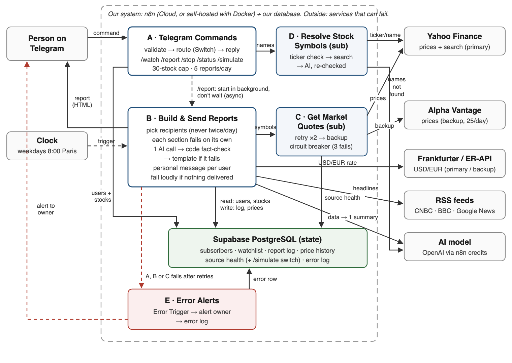
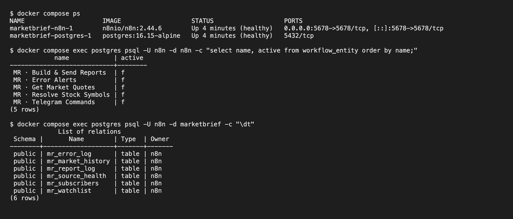
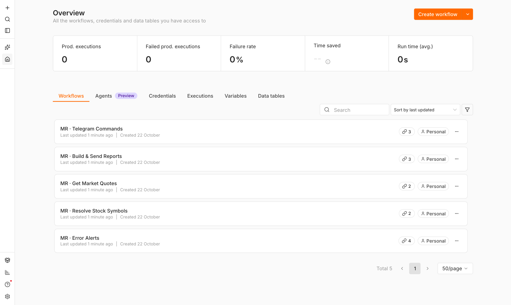
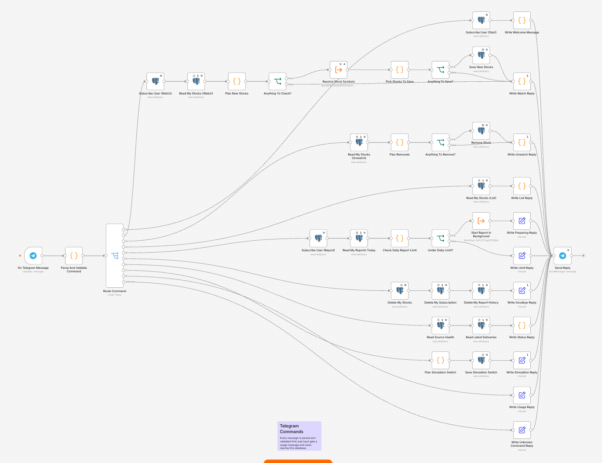
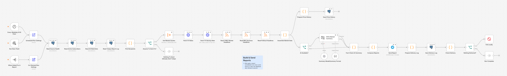
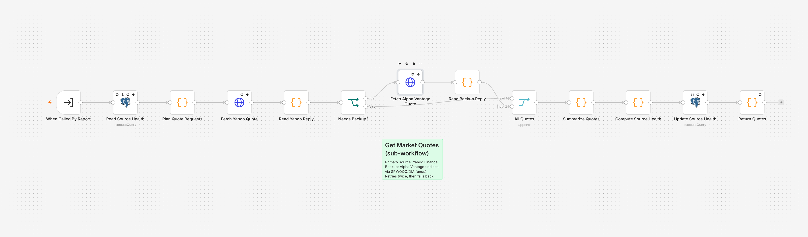
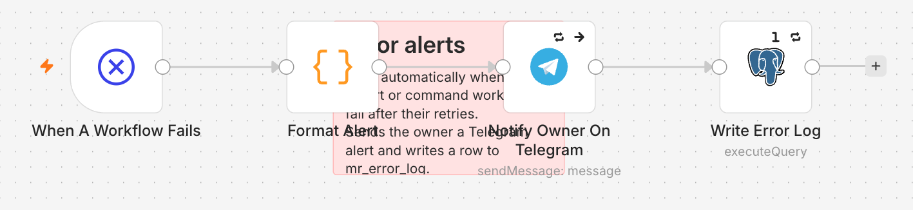

# MarketBrief: a Telegram morning market report built with n8n

**The need:** people who follow a few stocks open three or four apps every morning (a broker app, a currency converter, a news site) and still have to work out what matters for their own stocks.

MarketBrief is a Telegram bot. You tell it once which companies you follow (`/watch tesla, airbus, turkish airlines`). Every weekday at 08:00 Paris time it sends you one message with:
- the three US indices
- your stocks, sorted by how much they moved
- the dollar/euro rate
- the four most relevant headlines
- a 2–3 sentence summary written by AI and fact-checked by code before it is sent

It only reports and never advises.

Course project #20 ("Automated dashboard"), No Code course, Level 3. Full specification: [docs/MarketBrief_Proposal_Deha_Tanaci.pdf](docs/MarketBrief_Proposal_Deha_Tanaci.pdf).



Solid arrows mean the caller waits for the answer. Dashed arrows mean it doesn't wait. Each arrow is labelled with the data it carries. Everything outside the dashed box can fail, and each one has a retry and either a backup or a clearly labelled "unavailable" section in the report.

---

## What's in this repository

| Path | What it is |
|---|---|
| `docker-compose.yml` | Self-hosted n8n (pinned `2.44.6`) + PostgreSQL (pinned `16.15`), with named volumes and a database health check |
| `.env.example` | Every setting the stack needs. Copy it to `.env` (which Git ignores) |
| `database/schema.sql` | The six `mr_*` tables and the rules the database enforces itself |
| `database/init/` | Runs once on first start: creates the `marketbrief` database and loads the schema |
| `workflows/` | The five n8n workflows, exported as JSON. They are the exact versions running in the demo (the `versionId` in each file matches n8n's version history) |
| `docs/` | Proposal PDF, presentation script, architecture diagram, screenshots |

### The five workflows

| | Workflow | Trigger | Job |
|---|---|---|---|
| A | MR · Telegram Commands | Telegram message | Validates every message, then a Switch routes it: `/start /watch /unwatch /list /report /status /stop /simulate`. Unknown or malformed commands get a usage message |
| B | MR · Build & Send Reports | Schedule (weekdays 08:00 Paris), **Manual "Run Now (Test)"**, or called by `/report` | Fetches all data once and builds one personal report per subscriber. Never sends the same scheduled report twice. Makes one AI call, which code then fact-checks; if the check fails it falls back to a template |
| C | MR · Get Market Quotes (sub-workflow) | Execute Workflow, input `symbols` (array) | Yahoo Finance first, 2 retries, then Alpha Vantage as backup. Circuit breaker: stops calling Yahoo after 3 failures in a row |
| D | MR · Resolve Stock Symbols (sub-workflow) | Execute Workflow, input `terms` | Name → ticker. Tries an exact Yahoo check, then Yahoo search, then one AI call whose answers are re-checked on Yahoo |
| E | MR · Error Alerts | Error Trigger (set as Error Workflow on A–D) | Telegram alert to the owner with the workflow name, the failed step, the error and a link to the execution. Also writes a row to `mr_error_log` |

---

## Setup: from clone to running

You need Docker Desktop (or Docker Engine with Compose v2).

```bash
git clone https://github.com/DehaTanaci/marketbrief.git
cd marketbrief
cp .env.example .env
```

Edit `.env`:

| Variable | What to put |
|---|---|
| `POSTGRES_USER` / `POSTGRES_DB` | Keep `n8n` / `n8n` |
| `POSTGRES_PASSWORD` | A long random password (`openssl rand -hex 16`) |
| `N8N_ENCRYPTION_KEY` | `openssl rand -hex 32`. n8n uses this key to encrypt every saved credential. **Never change it after the first start**, or n8n can no longer read the credentials it saved |
| `GENERIC_TIMEZONE` | `Europe/Paris` (the 08:00 schedule uses it) |
| `WEBHOOK_URL` | Public HTTPS address of this n8n, needed for Telegram to reach it (see "Running the bot self-hosted" below). Leave the default for a local-only run |

Start it:

```bash
docker compose up -d
```

Postgres starts first. n8n waits until the database health check passes, then starts. On the very first start, Postgres also creates the `marketbrief` database with the six tables. Open **http://localhost:5678** and create the owner account.

Import the workflows:

```bash
docker compose exec n8n n8n import:workflow --separate --input=/workflows
```

They are imported **switched off** and keep their original IDs, so the links between them still work (sub-workflow calls and the Error Workflow setting).

### Credentials to create in n8n (Settings → Credentials)

No secret is stored in this repository. Create these four credentials in n8n, then open each workflow and select them on the nodes that show a warning:

| Credential (type) | Used for | Values |
|---|---|---|
| **Telegram account** (Telegram API) | Trigger, replies, reports, alerts | Bot token from @BotFather |
| **MarketBrief DB** (Postgres) | All `mr_*` tables | Self-hosted: host `postgres`, database `marketbrief`, user and password from `.env`. Live demo: Supabase session pooler, with "Ignore SSL Issues" on |
| **Alpha Vantage** (Query Auth) | Backup price source | Name `apikey`, value: your free key from alphavantage.co |
| **OpenAI** (OpenAI API) | Market summary + name → ticker | Your OpenAI API key. On n8n Cloud the built-in AI credits are used instead |

Then put your own Telegram chat ID in place of `YOUR_TELEGRAM_CHAT_ID` in two places:
- **A → Parse And Validate Command** (only this chat may use `/simulate`)
- **E → Format Alert** (who receives the error alerts)

The placeholder is committed on purpose.

Finally, in **A, B, C and D → Settings → Error Workflow**, check that **MR · Error Alerts** is selected, then activate A and B.

### Running the bot self-hosted

Telegram only delivers messages to a public HTTPS address. A laptop doesn't have one, so expose n8n through a tunnel (for example `cloudflared tunnel --url http://localhost:5678`). Put the tunnel address in `WEBHOOK_URL`, then run `docker compose up -d` again.

⚠️ A Telegram bot can deliver to **only one** n8n at a time. Activating the Telegram Commands workflow here takes the bot away from any other n8n using the same token. Use a separate test bot for self-hosted experiments.

The live demo runs on n8n Cloud (`deha-project.app.n8n.cloud`) with the same five workflow files and a Supabase PostgreSQL database that uses the same `schema.sql`.

### Check the stack is healthy and survives a restart

```bash
docker compose ps                       # both services "healthy"
docker compose down && docker compose up -d
docker compose exec postgres psql -U n8n -d n8n -c "select name, active from workflow_entity;"
```

The workflows, credentials and data are still there after the restart, because they live in the named volumes `n8n_data` and `postgres_data`. (`docker compose down -v` would delete those volumes.)

---

## How to test

**Without Telegram:** open **B · Build & Send Reports** and click **Run Now (Test)**. The manual trigger runs the same path as the 08:00 schedule. If today's report was already sent, the run stops at "Nothing To Send (Already Sent Today)". That is the never-send-twice rule working.

**With Telegram (talk to the bot):**

| Send | You should see |
|---|---|
| `/start` | Welcome message and the list of commands |
| `/watch tesla, airbus, turkish airlines` | TSLA and AIR.PA found by Yahoo search, THYAO.IS found by AI (marked "matched by AI") |
| `/list` | Your stocks |
| `/report` | "Preparing your report…" right away, then the full report about 15 s later |
| `/watch` (no names), `hello`, `/watch qwertyzzz` | A usage message or "not found". Nothing is saved |
| `/status` | Health of each data source and the last deliveries |

**Failure tests (owner only, via `/simulate`):**

| Send | Expected |
|---|---|
| `/simulate yahoo down`, then `/report` | Prices come from Alpha Vantage and the report shows a ⚠ "backup" note |
| `/simulate on alphavantage, news, ai`, then `/report` | The report is still delivered with what's left, plus one note per missing section; the summary falls back to the template |
| `/simulate fx down`, then `/report` | The backup currency rate is used |
| `/simulate reset` | Everything back to normal |
| Click **Run Now (Test)** twice | The second run sends nothing (never twice). The database also refuses a second scheduled log row for the same day |
| A real production failure | Owner gets a 🚨 Telegram alert with the workflow name, the failed step and the execution link |

All of these were run on the live bot on 21–22 October 2026. Results are in section 8 of the proposal.

---

## Screenshots

**Self-hosted stack running:** both services healthy, the five workflows imported (switched off), and the six bot tables created.



**The five workflows in the self-hosted n8n**



**A · Telegram Commands:** validate, then a Switch routes each command; every bad input ends in a usage reply



**B · Build & Send Reports:** three triggers (schedule, manual test, `/report`); AI summary with a structured output parser, a code fact-check and a template fallback



**C · Get Market Quotes:** Yahoo first, then Alpha Vantage only for what Yahoo couldn't serve



**E · Error Alerts**



---

## Known limitations

- **Yahoo Finance is unofficial** and can change without notice. That is why there is a backup source, a circuit breaker and per-section failure.
- **The fact-check verifies numbers, not direction.** "Fell 1.5%" for a 1.5% rise would pass.
- **Alpha Vantage free plan:** 25 requests per day, at least 1 second apart. The backup is only used for symbols Yahoo couldn't serve, one every 2 seconds.
- **One environment:** building and the live bot share one n8n instance. The Docker stack here is the second environment for testing.
